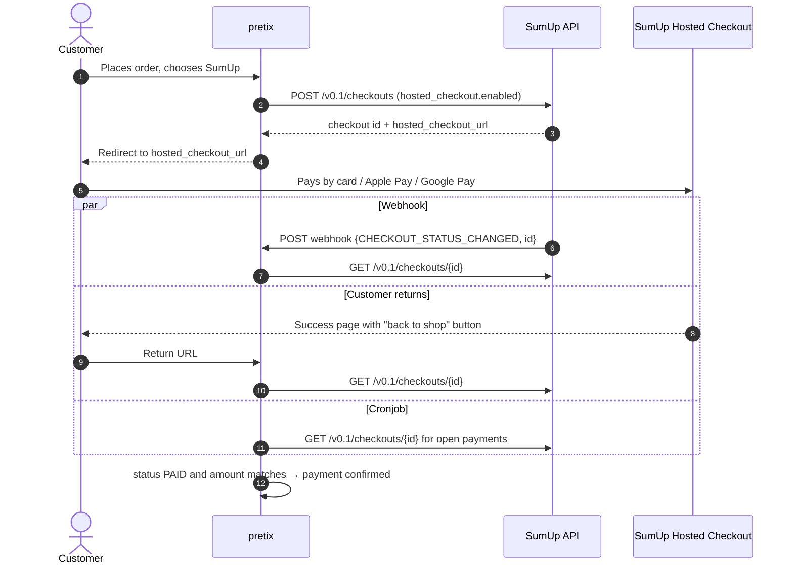

# pretix SumUp Hosted Checkout

`pretix-payment-sumup` is a payment provider plugin for [pretix](https://pretix.eu). It lets your
customers pay through [SumUp Hosted Checkout](https://developer.sumup.com/online-payments/checkouts/hosted-checkout),
a payment page that SumUp hosts. Customers can pay there by credit or debit card, Apple Pay or Google Pay.

The plugin is meant for self-hosted pretix installations where the organizer has a SumUp merchant
account.

## Features

- Redirects customers to the SumUp Hosted Checkout page, so no card data ever touches your server
  and no JavaScript widget is embedded in your shop.
- Confirms payments in three independent ways: when the customer returns, through SumUp webhooks,
  and by polling from the pretix cronjob. A payment is confirmed even if the customer closes the
  browser right after paying.
- Never trusts a redirect or a webhook on its own. The status is always fetched from the SumUp API,
  and a payment whose amount doesn't match is not confirmed.
- Supports full and partial refunds from the pretix backend.
- Uses a separate SumUp **sandbox** merchant account for orders placed in pretix test mode.
- Cancels the SumUp checkout when a pending payment is canceled in pretix.
- Includes English and German texts.

## How it works

Whichever path sees `PAID` first confirms the payment. The others then find it already confirmed
and do nothing.

## Where to go next

1. [Install the plugin](installation.md) into your pretix.
2. [Prepare your SumUp account](sumup-setup.md) and create API keys.
3. [Configure the payment method](configuration.md) for your event.
4. Read the [notes and gotchas](gotchas.md) before you go live.

To try it out first, the repository contains a [Docker Compose sandbox](sandbox.md).
